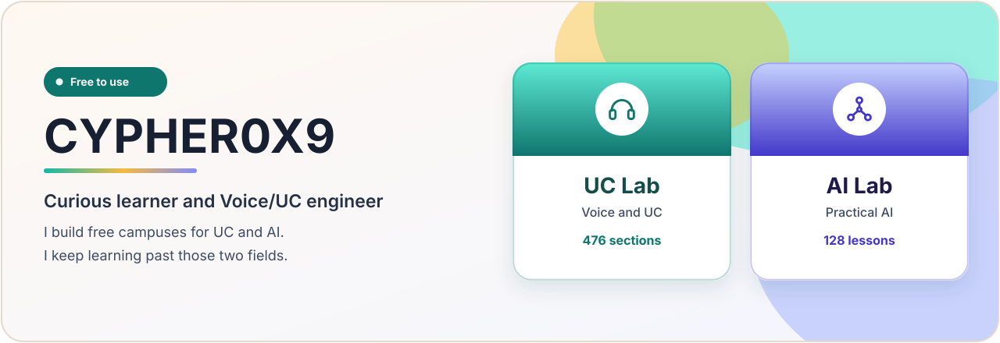
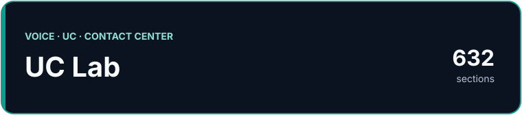
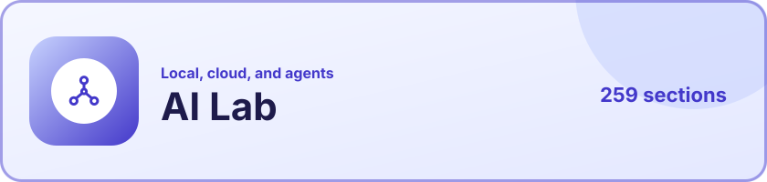
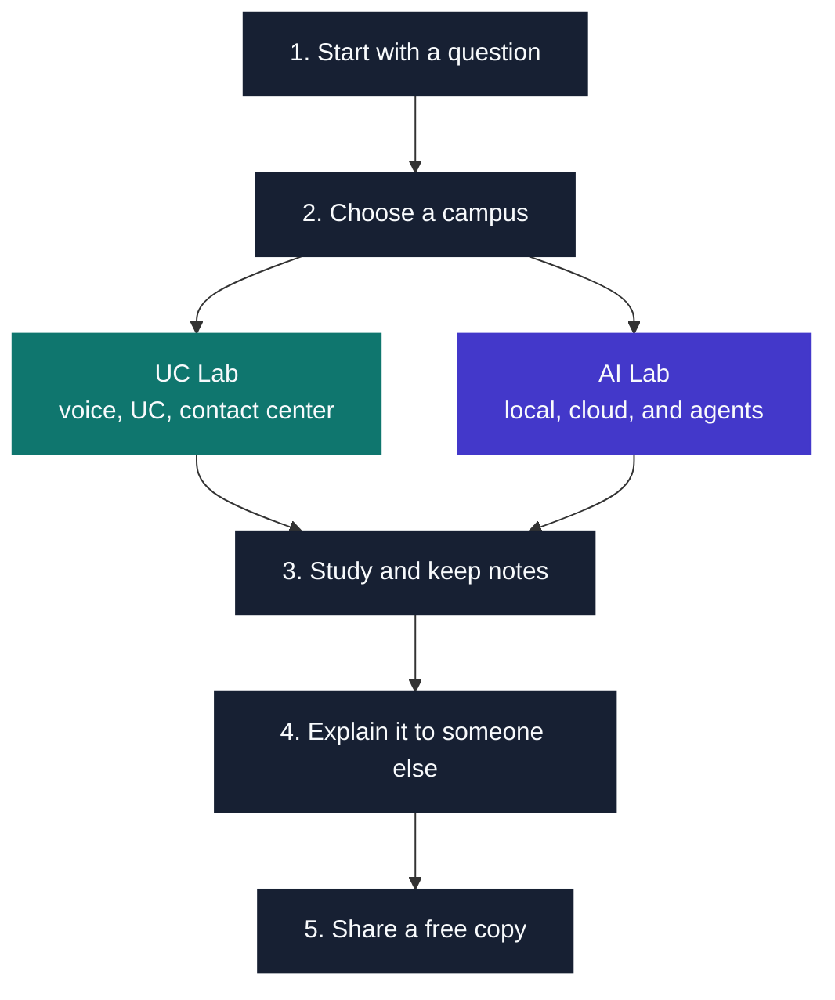

<!--
How to add a public repository

Use categories in this order: UC, AI, Research, Tools, Learning.
Skip a category until it has a public repository. Do not invent a row.

1. Featured campus. Copy one campus cell. A featured row is: campus, a narrow spacer cell, campus.
   Start a new row for a third campus. If a row has only one campus, omit the spacer and the empty cell.
   Point the banner, the Download link, and the Open link at the new repository, then rewrite the "What's inside" lines.
2. Every repository, including a featured campus, also needs a catalog row:

| Research | [Short name](REPO_URL) — one sentence on what it is | [Download](DOWNLOAD_URL) · [Open](REPO_URL) |

If there is nothing to download, link Open only.
-->

<p align="center">
  <picture>
    <source media="(prefers-color-scheme: dark) and (max-width: 640px)" srcset="./assets/hero-dark-narrow.svg">
    <source media="(max-width: 640px)" srcset="./assets/hero-light-narrow.svg">
    <source media="(prefers-color-scheme: dark)" srcset="./assets/hero-dark.svg">
    
  </picture>
</p>

<p align="center">
  
  
  
</p>

---

## About

I am a Voice and unified communications engineer, and a curious learner. I build free campuses for UC and AI because the work interests me, and because I want other people to be able to study it for free.

UC and AI are where I spend most of my time. When another subject is worth teaching clearly, I learn that too, and I share it the same way.

Each campus is an offline HTML file. It is free to use, it does not ask for an account, and it does not need an API key. I would like at least 99 people to learn from them.

## Projects and free downloads

The larger campuses are featured here. The table below is the full public list. Categories stay in this order: UC, AI, Research, Tools, and Learning.

### Featured

<table>
  <tr>
    <td width="48%" valign="top">
      <a href="https://github.com/cipher0x9/uc-lab-free-university-mesmerizing">
        
      </a>
      <p>A free offline campus for voice, unified communications, and contact center. It covers several vendors, and you can follow the material from start to finish. It is a single HTML file.</p>
      <p>
        <a href="https://github.com/cipher0x9/uc-lab-free-university-mesmerizing/releases/download/v21.0/uc-lab-free-university.html.zip"></a>
        &nbsp;
        <a href="https://github.com/cipher0x9/uc-lab-free-university-mesmerizing"></a>
      </p>
      <p><strong>What's inside</strong></p>
      <ul>
        <li>632 sections, and seven themes: Warm, Night, Cobalt, Forest, Aurora, Sunset, and Paper</li>
        <li>Mission Control dashboard, search, and an export center</li>
        <li>A record of your checks, using LICC: Leg, ID, Counter, and Capture</li>
        <li><a href="https://github.com/cipher0x9/uc-lab-free-university-mesmerizing/releases/download/v21.0/Enterprise-Voice-with-Cisco-Technologies-CC-Cloud-Migration.pptx">Enterprise Voice briefing</a>, 62 slides</li>
      </ul>
    </td>
    <td width="4%"></td>
    <td width="48%" valign="top">
      <a href="https://github.com/cipher0x9/ai-lab-free-university-mesmerizing">
        
      </a>
      <p>A free offline campus for practical AI. It covers local tools, cloud tools, agents, and ways to check your work. You can read it without an API key. It is a single HTML file.</p>
      <p>
        <a href="https://github.com/cipher0x9/ai-lab-free-university-mesmerizing/raw/main/downloads/ai-lab-university.html.zip"></a>
        &nbsp;
        <a href="https://github.com/cipher0x9/ai-lab-free-university-mesmerizing"></a>
      </p>
      <p><strong>What's inside</strong></p>
      <ul>
        <li>259 sections and 17 schools, with seven themes: Night, Cobalt, Aurora, Slate, Warm, Forest, and Paper</li>
        <li>Local models, cloud APIs, prompts, retrieval, agents, voice AI, evaluation, and safety</li>
        <li>A record of your checks, using RTMA: Run, Trace, Metric, and Artifact</li>
        <li><a href="https://github.com/cipher0x9/ai-lab-free-university-mesmerizing/raw/main/downloads/golden-slice.html.zip">A shorter file for a first visit</a> (golden slice)</li>
      </ul>
    </td>
  </tr>
</table>

### Full catalog

<p align="center">
  
  
  
  
  
</p>

| Category | Project | Links |
| --- | --- | --- |
| UC | [UC Lab Free University](https://github.com/cipher0x9/uc-lab-free-university-mesmerizing) — Offline campus for voice, UC, and contact center. 632 sections. | [Download](https://github.com/cipher0x9/uc-lab-free-university-mesmerizing/releases/download/v21.0/uc-lab-free-university.html.zip) · [Open](https://github.com/cipher0x9/uc-lab-free-university-mesmerizing) |
| AI | [AI Lab Free University](https://github.com/cipher0x9/ai-lab-free-university-mesmerizing) — Offline campus for practical AI. 259 sections. | [Download](https://github.com/cipher0x9/ai-lab-free-university-mesmerizing/raw/main/downloads/ai-lab-university.html.zip) · [Open](https://github.com/cipher0x9/ai-lab-free-university-mesmerizing) |

## What I am studying

These are subjects I am still learning, so I am not presenting them as finished work.

UC and AI still come first. I also work on other subjects when I can teach them clearly, and for free. At the moment those are AI agents, Webex, contact centers, and Sanskrit computing. I publish a note only when someone else could learn from it.

<p align="center">
  
  
  
  
</p>

## Tools I use

The campuses are plain HTML, so a normal browser can open them, including offline. These are the tools I use while I build and study.

<p align="center">
  
  
  
  
  
</p>

<p align="center">
  
  
  
  
  
</p>

## A simple path



This is only a map. The lessons are in the campuses.

<details>
<summary><strong>How to open a campus</strong></summary>

<br>

1. Choose a campus above and select **Download**.
2. Unzip the file.
3. Open the HTML file in **Chrome, Safari, Edge, or Firefox**. Use the browser itself, not a page opened inside another app.
4. On a phone, the UC campus can take a short time to open on the first visit. Let it finish loading.
5. You can read offline. The campuses do not ask for an account or an API key.
6. Keep a short record of what you checked.
   - **UC Lab** uses LICC: Leg, ID, Counter, and Capture.
   - **AI Lab** uses RTMA: Run, Trace, Metric, and Artifact.
7. For a short first look at the AI campus, download the [golden slice](https://github.com/cipher0x9/ai-lab-free-university-mesmerizing/raw/main/downloads/golden-slice.html.zip). The UC release also includes the [Enterprise Voice briefing](https://github.com/cipher0x9/uc-lab-free-university-mesmerizing/releases/download/v21.0/Enterprise-Voice-with-Cisco-Technologies-CC-Cloud-Migration.pptx) (62 slides).

</details>

<details>
<summary><strong>Copy, adapt, and share</strong></summary>

<br>

Both campuses are MIT licensed: [UC Lab](https://github.com/cipher0x9/uc-lab-free-university-mesmerizing/blob/main/LICENSE) · [AI Lab](https://github.com/cipher0x9/ai-lab-free-university-mesmerizing/blob/main/LICENSE).

```bash
git clone https://github.com/cipher0x9/uc-lab-free-university-mesmerizing.git
git clone https://github.com/cipher0x9/ai-lab-free-university-mesmerizing.git
```

1. Translate a section, add a lab, or adjust the path for the people you teach.
2. Keep the license file, and keep a link to the original repository.
3. Share your version for free, so someone else can open it offline.
4. Leave out private data, customer dial plans, tokens, and API keys.
5. This is educational material, and it has no warranty. Read the official documentation before you change a live system.

</details>

<p align="center">
  <a href="https://github.com/cipher0x9"></a>
</p>
