<picture>
<source media="(prefers-color-scheme: dark)" srcset="assets/banner_profile_dark.svg">
<source media="(prefers-color-scheme: light)" srcset="assets/banner_profile_light.svg">

</picture>

<h2 align="center">Hi, I'm Cypher Monkey 🐒</h2>

Lifelong student and AI builder · <b>@Cypher0x9</b>

     

## 👋 About me
I love learning in public. I build free study labs, tinker with AI, and try to explain hard things in plain English. If something helps me learn, I turn it into a lab so others can use it too.

## 🔭 What I'm into
- 🧠 Building with AI: agents, MCP, RAG and evals
- 🐍 Learning Python by making things that run
- 🧪 Free, offline-friendly study labs anyone can open in a browser
- 📜 Curious side quests, like Sanskrit grammar

## 🧪 The Labs
Everything below is free and opens right in your browser.

| Lab | What you'll find | Open |
|---|---|---|
| 🐍 **Python Lab** | Free Python university: runnable code, games, quizzes, 3D rooms. | [Open lab](https://cyphermonkeylabs.com/python-lab-free-university-mesmerizing/) |
| 🧠 **AI Lab** | 128 lessons: agents, MCP, RAG, evals, LoRA. | [Open lab](https://cyphermonkeylabs.com/ai-lab-free-university-mesmerizing/) |
| 💎 **Gemini Gems** | 33 copy-ready Gemini Gems with guide and starters. | [Open lab](https://cyphermonkeylabs.com/gemini-gems-free-gallery/) |
| 📜 **Sūtra Nexus** | Offline Sanskrit grammar study app. | [Open lab](https://cyphermonkeylabs.com/sutra-nexus/) |
| 📊 **Business Analyst Lab** | Free business analyst learning lab. | [Open lab](https://cyphermonkeylabs.com/ba-lab-grok-free-university-mesmerizing/) |
| 📡 **CPaaS Lab** | Twilio, Vonage, Bandwidth, Sinch, Telnyx and open options. | [Open lab](https://cyphermonkeylabs.com/cpaas-lab-free-university-mesmerizing/) |
| 📞 **SIP Universe Lab** | Free SIP campus experience. | [Open lab](https://cyphermonkeylabs.com/sip-universe-lab-free-university-mesmerizing/) |
| ☁️ **Amazon Connect Lab** | 18 tracks, 129 lessons, 24 labs. | [Open lab](https://cyphermonkeylabs.com/amazon-connect-lab-free-university-mesmerizing/) |
| 🪟 **Microsoft Voice & CC Lab** | 17 tracks, 110 lessons, 25 labs. | [Open lab](https://cyphermonkeylabs.com/microsoft-voice-cc-lab-free-university-mesmerizing/) |
| 🌐 **Genesys Cloud Lab** | Architect flows, routing, queues, APIs. | [Open lab](https://cyphermonkeylabs.com/genesys-cloud-lab-free-university-mesmerizing/) |
| 5️⃣ **Five9 Lab** | VCC admin, IVR, routing, WFM, APIs. | [Open lab](https://cyphermonkeylabs.com/five9-lab-free-university-mesmerizing/) |
| 🎥 **Webex Lab** | Control Hub, Calling, Contact Center, devices. | [Open lab](https://cyphermonkeylabs.com/webex-lab-free-university-mesmerizing/) |
| 🎧 **NiCE CXone Lab** | ACD, Studio, routing, IVR, WFM, APIs. | [Open lab](https://cyphermonkeylabs.com/nice-cxone-lab-free-university-mesmerizing/) |
| 🔊 **Zoom · Talkdesk · Avaya Lab** | Free contact center and UC study lab. | [Open lab](https://cyphermonkeylabs.com/zoom-talkdesk-avaya-lab-free-university-mesmerizing/) |
| 📟 **Voice & UC Lab** | 580 sections in 14 tracks, no CDN. | [Open lab](https://cyphermonkeylabs.com/uc-lab-free-university-mesmerizing/) |

> 🌱 **These are just the basics.** I'm learning and playing, and this is the start: we're building 100+ labs across every area, and there's much more to come.

## 🔗 Find me
- 🌐 [cyphermonkeylabs.com](https://cyphermonkeylabs.com)
- 🌳 [linktr.ee/CypherMonkey](https://linktr.ee/CypherMonkey)
- 🏠 [github.com/CypherMonkeyLabs](https://github.com/CypherMonkeyLabs)

> **Student project disclaimer:** These labs are independent learning projects made by a student. They are not affiliated with, endorsed by, or sponsored by any vendor or company named in them. Product names belong to their owners.

Always learning. 🐵

