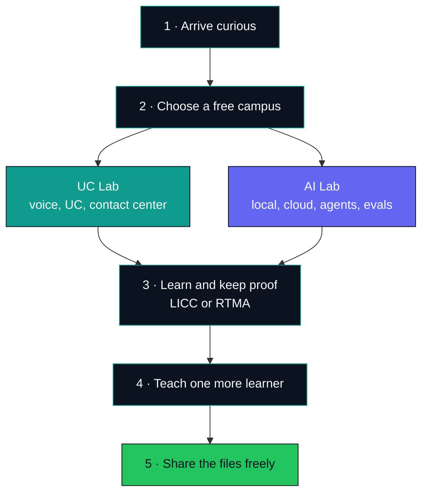

<p align="center">
  <picture>
    <source media="(prefers-color-scheme: dark) and (max-width: 640px)" srcset="./assets/hero-dark-narrow.svg">
    <source media="(max-width: 640px)" srcset="./assets/hero-light-narrow.svg">
    <source media="(prefers-color-scheme: dark)" srcset="./assets/hero-dark.svg">
    
  </picture>
</p>

<p align="center">
  
  
  
</p>

## A free education

I build free universities for people who want a real path, not a locked course. One campus is for voice, unified communications, and contact center. The other is for practical AI: local and cloud models, agents, and evals.

Both are offline HTML files. There is no fee, no account, and no API key required to read them. The aim is to teach 99 or more learners, anywhere, and to leave the files easy to share again.

## Two free universities

<table>
  <tr>
    <td width="50%" valign="top">
      <a href="https://github.com/cipher0x9/uc-lab-free-university-mesmerizing">
        
      </a>
      <br><br>
      A free offline campus for voice, unified communications, and contact center. Multi-vendor work, a clear path, and a habit of proof. One HTML file. No CDN.
      <br><br>
      <a href="https://github.com/cipher0x9/uc-lab-free-university-mesmerizing/releases/download/v20.2-resources/v17-UNIVERSITY.html.zip"></a>
      &nbsp;
      <a href="https://github.com/cipher0x9/uc-lab-free-university-mesmerizing"></a>
      <br><br>
      <strong>What's inside</strong>
      <ul>
        <li>632 sections and 7 themes: Warm, Night, Cobalt, Forest, Aurora, Sunset, Paper</li>
        <li>Mission Control dashboard, search, and an export center</li>
        <li>LICC proof: Leg, ID, Counter, Capture</li>
        <li><a href="https://github.com/cipher0x9/uc-lab-free-university-mesmerizing/releases/tag/v20.2-resources">Enterprise Voice briefing</a>, 62 slides, on the same release</li>
      </ul>
    </td>
    <td width="50%" valign="top">
      <a href="https://github.com/cipher0x9/ai-lab-free-university-mesmerizing">
        
      </a>
      <br><br>
      A free offline campus for practical AI. Local and cloud study, agents, evals, and proof habits. Readable with no API keys. One HTML file. No CDN.
      <br><br>
      <a href="https://github.com/cipher0x9/ai-lab-free-university-mesmerizing/raw/main/zips/v2-UNIVERSITY.html.zip"></a>
      &nbsp;
      <a href="https://github.com/cipher0x9/ai-lab-free-university-mesmerizing"></a>
      <br><br>
      <strong>What's inside</strong>
      <ul>
        <li>247 sections and 7 themes: Night, Cobalt, Aurora, Slate, Warm, Forest, Focus</li>
        <li>Local lab, cloud APIs, prompts, RAG, agents, voice AI, evals, and safety</li>
        <li>RTMA proof: Run, Trace, Metric, Artifact</li>
        <li><a href="https://github.com/cipher0x9/ai-lab-free-university-mesmerizing/raw/main/zips/v1-SLICE.html.zip">Starter slice</a> for a short first visit</li>
      </ul>
    </td>
  </tr>
</table>

## Currently learning

I am still a student. These are open studies, not finished claims.

<p align="center">
  
  
  
  
</p>

Agentic AI, Webex, contact center practice, and Sanskrit computing. I take them slowly, and I share a note only when it is clear enough to teach.

## Tools around the work

The campuses are plain HTML on purpose. These are the tools around that work.

<p align="center">
  
  
  
  
  
  <br><br>
  
  
  
  
  
</p>

## A path you can walk



The campuses are the path. The diagram is only the shape of it.

<details>
<summary><strong>How to use the labs</strong> — unzip, open, study offline</summary>

<br>

1. Pick a campus above and use **Download**.
2. Unzip the file.
3. Open the HTML in **Chrome, Safari, Edge, or Firefox**. Use the full browser, not an in-app browser.
4. On a phone, the UC campus can take a short while the first time. Wait for it.
5. Read offline. The campuses do not ask for an account or an API key.
6. Keep proof as you practice.
   - **UC Lab — LICC:** Leg, ID, Counter, Capture.
   - **AI Lab — RTMA:** Run, Trace, Metric, Artifact.
7. Want the short AI visit first? Use the [starter slice](https://github.com/cipher0x9/ai-lab-free-university-mesmerizing/raw/main/zips/v1-SLICE.html.zip). The UC [release](https://github.com/cipher0x9/uc-lab-free-university-mesmerizing/releases/tag/v20.2-resources) also includes a 62-slide Enterprise Voice briefing.

</details>

<details>
<summary><strong>Remix them</strong> — clone, adapt, share again</summary>

<br>

Both campuses are MIT licensed: [UC Lab](https://github.com/cipher0x9/uc-lab-free-university-mesmerizing/blob/main/LICENSE) · [AI Lab](https://github.com/cipher0x9/ai-lab-free-university-mesmerizing/blob/main/LICENSE).

```bash
git clone https://github.com/cipher0x9/uc-lab-free-university-mesmerizing.git
git clone https://github.com/cipher0x9/ai-lab-free-university-mesmerizing.git
```

1. Translate a section, add a lab, or rebuild the path for learners you know.
2. Keep the license file, and keep a link back to the original repository.
3. Share your copy the same way: free, offline, and easy to open.
4. Leave out private data, customer dial plans, tokens, and API keys.
5. This is educational material. It has no warranty. Read the official documentation before you change a live system.

</details>

<br>

<p align="center">
  <a href="https://github.com/cipher0x9"></a>
</p>

<p align="center">
  <em>Build calmly. Prove carefully. Share freely for learning.</em>
</p>
